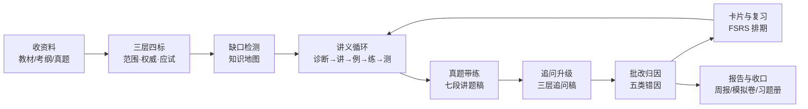

# study-coach · 通用学习教练

> 一个可以直接加载进 Agent 的备考 Skill：把教材、考纲、真题变成一条可恢复的「诊断—讲—例—练—测—复习」流水线。


A general-purpose exam-prep coach skill for AI agents. It turns textbooks, syllabi, and past papers into a recoverable study pipeline, with structure checks and routing evals built in.

---

## 它解决什么问题

大多数「AI 学习助手」停在两个极端：要么只会聊天式讲解，讲完就散；要么只会刷题，错了也不归因。这个 Skill 把备考拆成可执行、可回指、可验收的流程：

- 资料不是一锅粥：教材、考纲、真题分层裁决，冲突有固定规则。
- 讲题不是散文：讲题稿固定七段，追问固定三层，缺段由脚本判失败。
- 错误不是一句「粗心」：按概念 / 运算 / 表述 / 方法选择 / 审题五类归因。
- 复习不是拍脑袋：按 `reviews.jsonl` 回放 FSRS，算下次到期。
- 结论不靠文风：能符号验算就先验算，未验的标 `[未验]`。

## 适合谁

| 适合 | 说明 |
| --- | --- |
| 有明确考试的学生 | 期末、考研、资格证、语言考试，手上有教材 / 考纲 / 真题 |
| 自学者 | 需要把零散资料整理成范围、知识地图和复习队列 |
| 一对一辅导场景 | 需要稳定产出讲题稿、批改结论、变式题与复习计划 |
| 想审计 AI 讲解的人 | 每个结论要求来源页码或验算记录，不接受「显然」 |

**不适合**：多学生隔离 / 租户、共享题库、K12 课标图谱。这些在需求阶段就明确不做，代码里也没有预留半成品。

## 核心流程



主循环七步：资料标定 → 范围校准 → 知识地图 → 讲义循环 → 批改归因 → 真题带练 → 沉淀收口。每一步都有对应文档或脚本，不靠模型自由发挥。

## 功能地图

### 1. 资料与范围

- 三层模型：范围层（考纲 > 教材）、权威层（经典 > 教材 > 教辅）、应试层（真题 > 考纲 > 模拟题）。
- 四标入库：`layer / kind / trust / coverage` 缺一项只能进临时区。
- 冲突裁决固定四条，每次冲突落一条 `CONF` 记录。
- 缺口检测输出三类：考纲有教材无、真题有教材无、教材有考纲无。
- 教材换版：章节 diff、页码偏移、已退役题清单。

### 2. 试卷与教材导入

| 能力 | 入口 |
| --- | --- |
| 判断 PDF 走文本层还是 OCR（A/B/mixed） | `scripts/pdf_probe.py` |
| 扫描页 / 拍照单页 OCR，低置信标「待核」 | `scripts/ocr_page.py` |
| 从文本或 OCR 结果切出题目草稿，小数不误切 | `scripts/slice_questions.py` |
| 多栏 / 跨页：自动提案题号区域，模型复核 bbox 后裁图 | `scripts/page_regions.py --suggest` |
| 题目 schema、题数、分值、总分、题型分布质检 | `scripts/intake_check.py` |
| 印刷目录抽取，供模型校对成章节树 | `scripts/toc_extract.py` |

质量门不通过就不入库，不把「大概齐」当数据。

### 3. 讲解与追问

讲题稿固定七段：

```text
题目复述 → 定性 → 完整步骤 → 考场精简写法 → 验算与边界 → 易错点（含同类题对比）→ 一句话总结
```

追问固定三层：

```text
一句话结论 → 至少两种视角 + 数值验证表 → 记号/定义拆解
```

写完跑 `scripts/explain_lint.py`：缺段、易错点少于 3 条、追问少于两个视角、没有数值验证表，都会退出 1。结构不合格不算成稿。

### 4. 批改、记忆与复习

- 五类错因：概念 / 运算 / 表述 / 方法选择 / 审题。
- 每个高频误解配 1 道探测题；错题沉淀进 `records/errors.jsonl`。
- 多步卡按最弱一步评分，不是二值回忆。
- FSRS 排期：回放历史算 `due / interval_days`；未装 `fsrs` 时显式降级四档阶梯，字段不变。
- 掌握度用证据计数四级（L0–L3），样本 < 5 只报「证据不足」，不估概率。

### 5. 知识库、检索与报告

- 三平面存储：`notes/` 叙述层、`records/` 只追加记录层、`views/` 可重建派生层。
- 混合检索：SQLite FTS5（BM25）+ 字符 bigram 余弦 + RRF，可降级到 `bm25` 或 `vector`。
- 题型卡片、易错点汇总、学情快照、双链反查、高频困惑点统计。
- 整卷报告：题型分布、分值、考点分布、难度曲线、陷阱清单、高频母题。
- 模拟卷：按原卷结构生成组卷蓝图与逐步 rubric。
- 习题册导出：Markdown / 可打印 HTML，题目区与答案区分开。
- 周报：事件、退出票、复习、错题、困惑一次汇总。

## 快速开始

### 1. 安装

```bash
git clone https://github.com/geyadawang-boop/study-coach.git
```

把 `study-coach/` 放进你的 Agent 技能目录（例如 `~/.trae-cn/skills/study-coach`，具体以你所用的客户端为准），入口文件是 `SKILL.md`。

核心脚本只用 Python 标准库；以下依赖按需安装：

```bash
pip install fsrs            # FSRS 复习排期，缺失时自动降级四档阶梯
pip install pymupdf         # PDF 文本层/渲染；未装时 PDF 相关脚本提示并跳过
pip install sympy           # 步骤等价与特殊值验算
```

### 2. 第一次对话

直接说你要准备什么考试、手上有什么资料：

```text
我两周后期末考试，教材和老师划的范围在附件里，帮我建个复习计划。
```

Skill 会先收「主教材 / 考纲 / 考试信息」三件套，再按三层四标入库、检测缺口、建知识地图，然后才开始讲。

### 3. 常用说法

| 你说 | 它会做 |
| --- | --- |
| 我下周考试，手上只有教材和老师划的范围，资料该怎么分级 | 资料分层与缺口检测 |
| 把这份期中卷子导进来，整理成能统计的题目数据 | PDF 判定 → 切题 → 质量门 |
| 这题我没有思路，先别告诉我完整解法 | 五级提示，从最低级开始 |
| 这题讲完帮我检查讲题稿七段有没有缺 | `explain_lint.py` 结构检查 |
| 追问稿只有一种推导，够不够深 | 追问三层检查 |
| 我这张卡什么时候再复习 | 回放复习历史算 FSRS 到期 |
| 分析一下这份真题卷都考了什么，分值怎么分布 | 整卷报告 |
| 把错题导出成能打印的册子 | 习题册导出 |

## 目录结构

```text
study-coach/
├── SKILL.md                 # 技能入口：触发语、主循环、硬规则、完成标准
├── checks.json              # 26 项验收清单
├── references/              # 8 份协议文档 + capabilities.json（24 项能力契约）
│   ├── source-layers.md     # 资料分层、冲突裁决、缺口检测
│   ├── lecture-and-drill.md # 九步讲义循环、七段讲题、三层追问
│   ├── paper-intake.md      # 试卷导入、切题、质量门
│   ├── error-taxonomy.md    # 五类错因、变式协议、对比式评分
│   ├── knowledge-base.md    # 三平面存储、卡片、掌握度、复习
│   ├── output-contract.md   # 输出模板、公式渲染、引用规则
│   ├── research.md          # 检索、引用回指、失败降级
│   └── tech-stack.md        # 选型、依赖、升级触发条件
├── scripts/                 # 20 个可执行脚本
├── subjects/calculus/       # 学科插件：考纲、渲染、题型、误解库、术语
├── evals/                   # 20 条行为用例、29 条检索、42 条路由、13 个 fixture
└── agents/openai.yaml       # Agent 接口描述
```

新增学科只写 `subjects/<学科>/`，不改主循环。

## 质量门与实测

```bash
python scripts/run_checks.py --skill-root . --kb <你的学习库>
# passed=26 failed=0 skipped=0

python scripts/route.py --eval evals/routing.jsonl
# top1=41/42 (98%)  top3=42/42 (100%)
```

当前基线：

| 项目 | 数量 / 结果 |
| --- | --- |
| 验收检查 | 26 项，全部 PASS |
| 可执行脚本 | 20 个 |
| 能力契约 | 24 项，entry/reference 全部指向真实文件 |
| 行为评测 | 20 条 |
| 检索评测 | 29 条真实问法，hybrid hit@5 全中 |
| 路由回归 | top1 98%，top3 100% |
| 真实学习库体检 | 无 error |

这些数字由脚本产出，不靠 README 自证；`run_checks.py` 会检查 `checks.json` 与实现是否一致。

## 设计原则

- **证据优先**：能验算就验算，未验的标 `[未验]`；不靠文风判对错。
- **不替用户思考**：作业模式先给思路链，用户写出解法再批改。
- **不编题**：题面、选项、条件缺失先索取；年份、卷别不确定标「待核」。
- **引用可回指**：`DOC-0001#p58` 或 URL；指不到就删。
- **本地优先**：教材、真题、作业不外传；外部检索只发必要片段。
- **三态声明**：每次改动明确说「已应用 / 部分应用 / 需手工」。
- **公式双轨**：聊天窗用 Unicode（π、≤、x²、分段代码块），`notes/*.md` 才用 LaTeX。
- **单用户、可解释**：不做掌握度概率预测，不做多 Agent 互评，不引入黑箱记忆。

## 已知边界

- `explain_lint.py` 只查结构下限，不评讲解质量；文风与类比是否贴切仍靠模型自评与用户反馈。
- OCR 与多栏切题的 bbox 需要模型复核，低置信内容标「待核」，不自动猜。
- 路由 top1 为 98%：个别说法会先命中讲义入口，但 top3 能兜住。
- 外部检索依赖网络，超时后显式降级，不会静默卡住。
- PDF / OCR / SymPy 相关检查在依赖缺失时会 SKIP，不会假装通过。

## 数据与隐私

- 仓库只包含 Skill 本体（规则、脚本、样例），不包含任何个人学习库。
- 运行时默认在工作目录创建 `学习库/`，教材、试卷、笔记、复习记录都留在本地。
- `.gitignore` 已排除 `学习库/`、`.index/`、`__pycache__/`，避免误提交个人数据。

## 反馈

发现问题时，最有用的反馈不是「讲得不好」，而是一个可复现的输入：

1. 原始说法；
2. 期望入口或输出；
3. 实际结果；
4. 如果涉及讲题，附上哪一段缺失。

新增规则时按「改协议 → 加 fixture → 加检查」走，避免只改文档不落测试。
