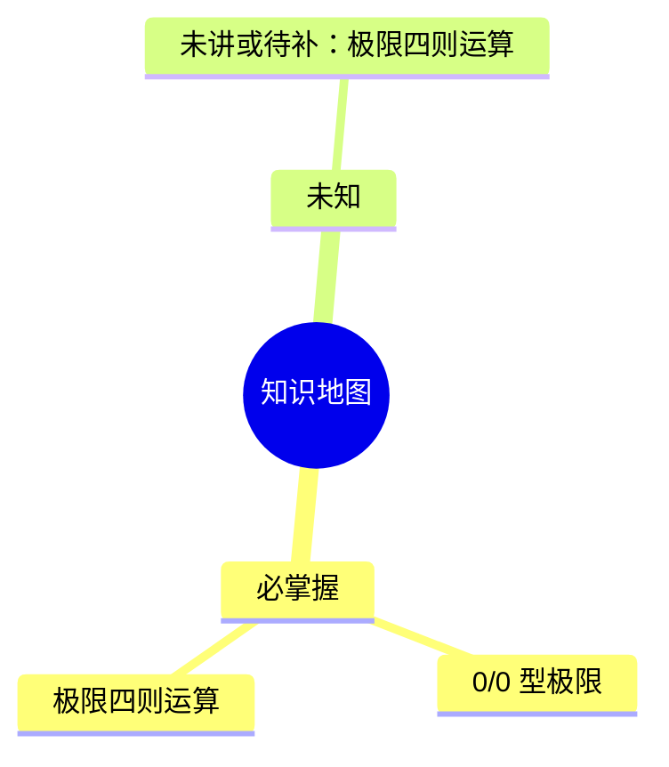

<!-- generated by scripts/structure_map.py; do not edit by hand -->

# 结构地图

> 由 `scripts/structure_map.py` 从 `01-知识地图.md` 生成，不手改。
> 按优先级分组，不按教材章节顺序；依赖边只画前置关系。

## 重难点清单

| 档位 | 数量 | 知识点 |
| --- | --- | --- |
| 必掌握 | 2 | 0/0 型极限、极限四则运算 |
| 高频 | 0 | - |
| 了解 | 0 | - |

## 依赖关系

| 先学 | 后学 |
| --- | --- |
| 极限四则运算 | 0/0 型极限 |

## 未知区域

- 未讲或待补：极限四则运算
- 无证据：极限四则运算

## 自检

- 知识点 2 个，依赖边 1 条。
- 必掌握 2 个，占 100%。
- 一级分支 1 个。
- 门槛通过：优先级有区分、依赖边数量受控、无环。
