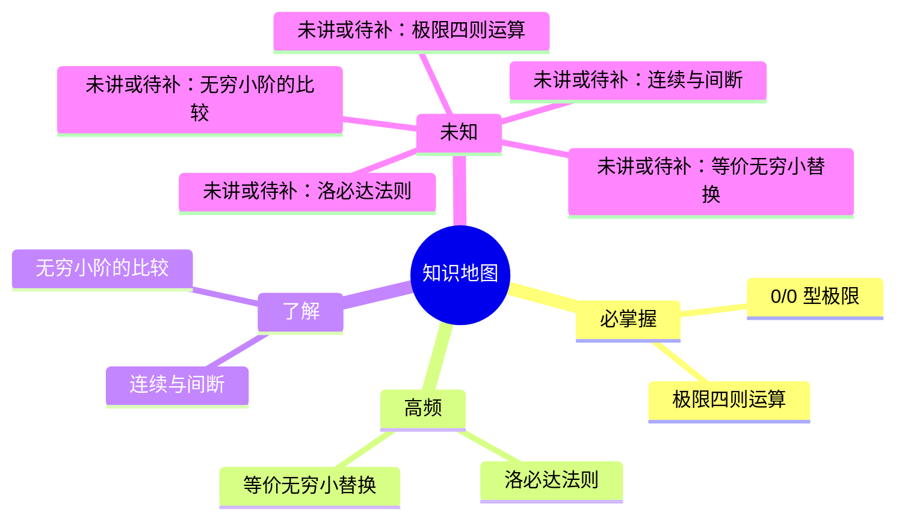

<!-- generated by scripts/structure_map.py; do not edit by hand -->

# 结构地图

> 由 `scripts/structure_map.py` 从 `01-知识地图.md` 生成，不手改。
> 按优先级分组，不按教材章节顺序；依赖边只画前置关系。

## 重难点清单

| 档位 | 数量 | 知识点 |
| --- | --- | --- |
| 必掌握 | 2 | 0/0 型极限、极限四则运算 |
| 高频 | 2 | 等价无穷小替换、洛必达法则 |
| 了解 | 2 | 无穷小阶的比较、连续与间断 |

## 依赖关系

| 先学 | 后学 |
| --- | --- |
| 极限四则运算 | 0/0 型极限 |
| 极限四则运算 | 等价无穷小替换 |
| 0/0 型极限 | 洛必达法则 |
| 等价无穷小替换 | 无穷小阶的比较 |
| 极限四则运算 | 连续与间断 |

## 未知区域

- 未讲或待补：极限四则运算、等价无穷小替换、洛必达法则、无穷小阶的比较、连续与间断
- 无证据：极限四则运算、等价无穷小替换、洛必达法则、无穷小阶的比较、连续与间断

## 自检

- 知识点 6 个，依赖边 5 条。
- 必掌握 2 个，占 33%。
- 一级分支 3 个。
- 门槛通过：优先级有区分、依赖边数量受控、无环。
